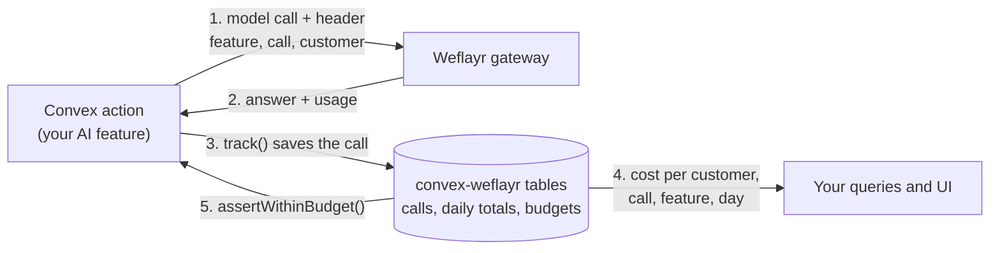

# convex-weflayr

A Convex component that sends your app's model calls through the
[Weflayr](https://weflayr.com) gateway, and saves what each call cost, per
customer, in your own database.

Weflayr can show cost, run benchmarks and compare models, but only if every
request says which feature, which call and which customer it belongs to. In a
Convex app you would build that header by hand on every call, and the cost data
would stay in Weflayr's dashboard, out of reach of your own code. This component
adds the header for you and writes each call's usage into tables your app can
query. So your app can act on cost: show a customer their usage, warn at 80% of
a plan, stop at 100%.



## What you get

- **Cost per customer.** Every call is saved with its customer, call name,
  feature, plan, model, tokens, cost, latency and status. Totals by customer,
  call, feature and day are one query away, and they update live in your UI.
- **Budgets.** Give a customer a monthly dollar budget. Their next call is
  stopped before the model runs, and other customers carry on.
- **Agent runs.** Give every step of a run the same run id. You see what the run
  cost, step by step, and you can stop it part way.
- **Cheaper models, with proof.** Each call has a fixed name, so Weflayr can
  replay your real calls on other models and score the answers.
- **Calls that survive a gateway failure.** `withFallback()` can run the call
  direct if the gateway fails. This is optional.
- **A Vercel AI SDK model** for the gateway, if you use the AI SDK.

## Try the demo

The `example/` folder is a small app that uses every part of the component. It
makes real calls, so you bring your own Weflayr key: sign up at
[app.weflayr.com](https://app.weflayr.com), create an API key, and paste it into
the app. You do not need a key from any model provider.

```sh
npm install
npx convex dev   # asks you to log in, then creates a project
npm run dev
```

`npx convex dev` writes `CONVEX_URL` to `.env.local`. The Vite app reads
`VITE_CONVEX_URL`, so add a line with the same address:

```sh
VITE_CONVEX_URL=https://your-deployment.convex.cloud
```

Open the app and paste your key. Then:

- **Send calls** sends one call, or runs a four-step agent and shows its cost
  step by step.
- **Customers** shows spend per customer, call and day.
- **Budgets** sets a monthly budget and stops a customer who has used it.
- **Calls** lists every saved call.

About your key: it is saved in your browser's localStorage and sent with each
call so the call can be made. It is never saved in the database. Each browser
gets a random id, so you only see your own calls. The database holds the
customer name, call name, model, token counts, cost, latency and status of each
call, and no prompt or answer text.

## Install

```sh
npm install convex-weflayr
```

Add the component to `convex/convex.config.ts`:

```ts
import { defineApp } from "convex/server";
import weflayr from "convex-weflayr/convex.config";

const app = defineApp();
app.use(weflayr);

export default app;
```

Set your Weflayr key and the customers that may use the gateway:

```sh
npx convex env set WEFLAYR_API_KEY <your Weflayr key>
npx convex env set WEFLAYR_CUSTOMERS "*"
```

`WEFLAYR_CUSTOMERS` is a comma separated list of customer ids, or `*` for all.
When it is empty, no customer goes through the gateway.

## Use it

Create one `Weflayr` instance. Name your calls and the feature each one belongs
to. A benchmark in Weflayr is set up per call name, so keep the names stable.

```ts
import { Weflayr } from "convex-weflayr";
import { components } from "./_generated/api";

export const weflayr = new Weflayr(components.weflayr, {
  features: {
    "draft-reply": "support-replies",
    "classify-ticket": "support-replies",
    "summarise-thread": "thread-summaries",
  },
  // Dollars per million tokens, from your provider's price list.
  prices: {
    "claude-haiku-5-5": { inputPerMillion: 0.1, outputPerMillion: 0.5 },
  },
});
```

Call a model through the gateway with the AI SDK:

```ts
import { generateText } from "ai";
import { weflayrModel } from "convex-weflayr/ai-sdk";

const meta = { customer: workspace.name, plan: workspace.plan, call: "classify-ticket" };

const result = await weflayr.track(
  ctx,
  { ...meta, model: "claude-haiku-5-5" },
  () =>
    generateText({
      model: weflayrModel(weflayr, "claude-haiku-5-5"),
      headers: weflayr.headers(meta),
      prompt,
    }),
);
```

`ctx` is any action context. `track` times the call and saves it. If the call
fails, it saves the failure and throws the error again. Without the AI SDK,
`weflayr.connection()` returns the base URL and key for any OpenAI compatible
client.

### Keep a call alive if the gateway fails

`withFallback` tries the gateway first. If it fails, it runs the same call
direct, so your customer still gets an answer. You supply the direct call, with
your own provider key.

```ts
const result = await weflayr.withFallback(
  ctx,
  { ...meta, model },
  {
    gateway: () => generateText({ model: weflayrModel(weflayr, model), headers: weflayr.headers(meta), prompt }),
    direct: () => generateText({ model: yourProvider(model), prompt }),
  },
);
```

The failed attempt is saved as `error` and the direct run as `fallback`. A
customer who is not on the allow list runs the direct call, and that call is not
saved.

### Group the calls of one job

Pass the same `runId` (`newRunId()` makes one) to every call of one job. It is
saved with each call and sent to Weflayr as the `run_id` tag.
`weflayr.runCost(ctx, runId)` returns the cost of the whole job and of each
step.

Weflayr also runs an MCP server at `https://mcp.weflayr.com/`, so an agent can
read cost and margin as a tool.

### Budgets

```ts
await weflayr.setBudget(ctx, "acme", 25); // 25 dollars a month, UTC calendar month
await weflayr.assertWithinBudget(ctx, "acme"); // throws WeflayrBudgetError once spent
const status = await weflayr.budget(ctx, "acme"); // { limitUsd, spentUsd, remainingUsd, allowed }
```

A customer without a budget always passes. Spend is the sum of saved cost for
the month. A call already running when the limit is reached can still finish.

### Read the numbers

```ts
const range = lastDays(30);
await weflayr.usageByCustomer(ctx, range);
await weflayr.usageByCall(ctx, range, "acme");
await weflayr.usageByFeature(ctx, range);
await weflayr.usageByDay(ctx, range, "acme");
await weflayr.recentCalls(ctx, { customer: "acme", limit: 20 });
```

Each row has `calls`, `errors`, `fallbacks`, `inputTokens`, `outputTokens`,
`costUsd` and `averageLatencyMs`. Inside a Convex query, call
`ctx.runQuery(components.weflayr.lib.usageByCustomer, range)` and the result
updates live in your UI.

## How cost is worked out

The gateway does not send a price back with each response, so the component
uses, in order:

1. A cost you pass: `costUsd` in the call details, or from `extract` in `track`.
   Saved as `reported`.
2. An estimate from your `prices` table. Saved as `estimated`.
3. Zero, saved as `none`, when neither is available.

Weflayr's dashboard is the source of truth for what you were billed. Use the
saved cost to compare customers and enforce budgets, and fill `prices` from your
provider's price list.

## What is saved

| Table     | One row per                | Kept                                       |
| --------- | -------------------------- | ------------------------------------------ |
| `calls`   | model call                 | until you run `weflayr.purge(ctx, before)` |
| `daily`   | customer, call and UTC day | always                                     |
| `budgets` | customer                   | until cleared                              |

Queries read the `daily` rows, so they stay fast as `calls` grows. Days and
months are UTC.

## Notes

- Saving a call never fails the call. If the write fails, the component logs a
  warning and returns your answer.
- The `plan`, `runId` and any `tags` you pass are sent to Weflayr as tags on the
  request.
- Customer names go to Weflayr as written. Use an id or a name you are happy to
  see in its dashboard.

## Limitations

- Cost is an estimate from your `prices` table unless you pass the cost of a
  call.
- A budget compares saved cost with the limit before a call starts, so a call
  already running can push a customer past it.
- A customer who is not on the allow list runs the direct call, and that call is
  not saved.

## Troubleshooting

**No calls are saved.** The customer is not allowed through the gateway. Set
`WEFLAYR_CUSTOMERS` to the customer id, or `*`, and check that
`WEFLAYR_API_KEY` is set in the same Convex deployment.

**Cost shows $0.** The model is missing from `prices`. Add it, in dollars per
million tokens.

**A budget never stops anyone.** A budget compares saved cost, so it needs
`prices`, or a `costUsd` on each call.

**The gateway returns 402.** Your Weflayr balance is empty. Add credit in the
Weflayr dashboard.

## Test

```ts
import { convexTest } from "convex-test";
import { register } from "convex-weflayr/test";

const t = convexTest(schema, modules);
register(t); // or register(t, "myName") if you named the component yourself
```

## Contributing

```sh
npm install
npm test
npm run lint
npm run typecheck
npm run build
```

See [CONTRIBUTING.md](./CONTRIBUTING.md). To publish, see
[PUBLISHING.md](./PUBLISHING.md).

## Changelog

See [CHANGELOG.md](./CHANGELOG.md).

## License

Apache-2.0
