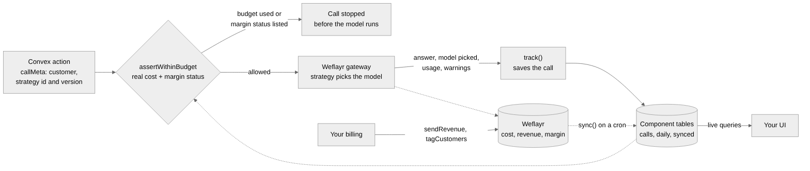
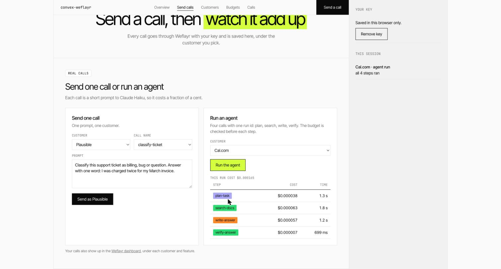
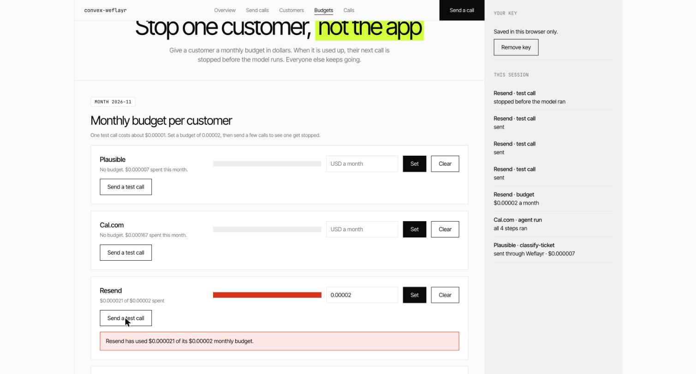
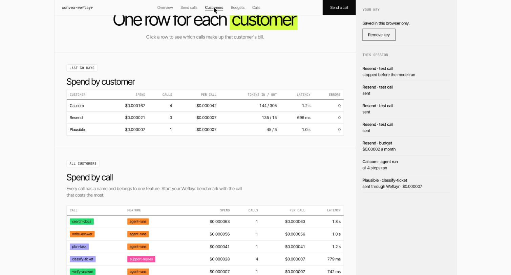
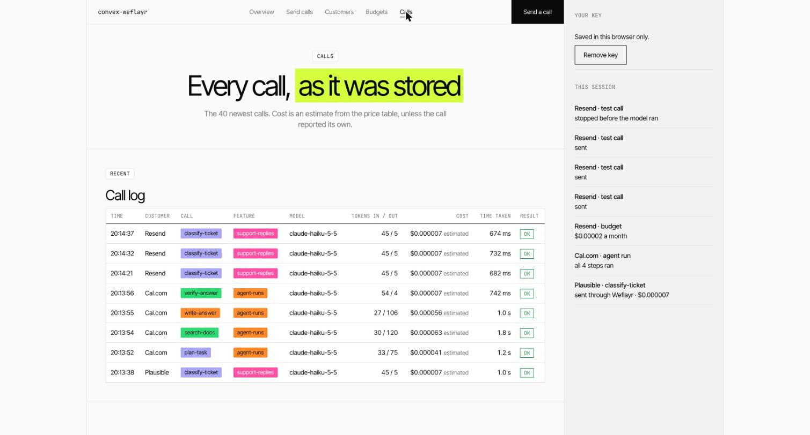
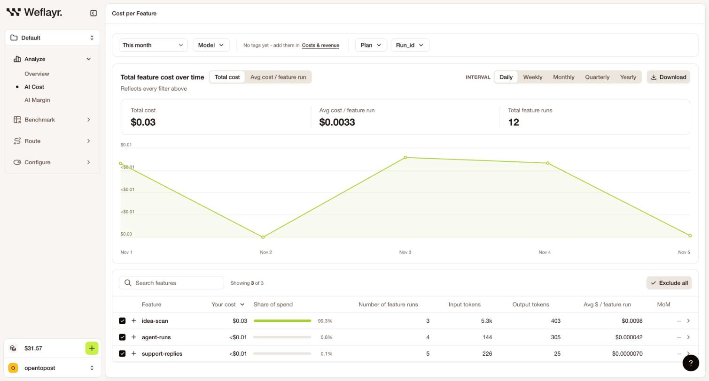

# convex-weflayr

A Convex component for running your app on [Weflayr](https://weflayr.com)
routing strategies, with every call tagged by the customer it serves. It also
brings Weflayr's real cost and margin per customer back into your Convex
database, so your app can show it and act on it.

Weflayr is a gateway that decides which model answers each call. You benchmark
your own calls on other models, save the result as a routing strategy, and your
code sends `model: "strategy/<id>"`. Weflayr then picks the model per call, and
its routing overrides can treat a customer differently by their cost or their
margin. All of that depends on each call saying which customer, feature and call
it belongs to. This component does that in a Convex action, and keeps what comes
back where your queries can reach it.



## What you get

- **The customer on every call.** Read from your login or your own function.
  Per-customer routing overrides, cost and margin in Weflayr all depend on it.
  A call without a customer fails by default, so none go untagged.
- **Strategies instead of model names.** `strategy("support", 3)` pins a version
  in production and `strategy("support")` follows the latest. Changing which
  model answers is a change in the Weflayr dashboard, not a deploy. Each call is
  saved with the model the strategy picked.
- **Revenue and plan into Weflayr.** Push revenue from any billing system and
  tag customers with their plan, so margin and per-plan views work.
- **Weflayr's cost and margin in your database.** `sync` saves each customer's
  real cost, revenue, margin and risk status for the month. Show it in your UI
  with a live query, and stop a customer whose margin status you list.
- **Budgets.** A monthly dollar budget per customer, checked against that real
  cost. The next call is stopped before the model runs, and other customers
  carry on.
- **Agent runs.** Every step of a run carries one feature run id, so Weflayr
  prices the whole run. You can also read the run's cost step by step and stop
  it part way.
- **A per-call record.** Every call is saved with customer, call, feature, plan,
  model, tokens, cost estimate, latency and status, for lists in your own UI.
- **Calls that survive a gateway failure.** `withFallback()` can run the call
  direct if the gateway fails. This is optional.
- **A Vercel AI SDK model** for the gateway, if you use the AI SDK.

## Try the demo

The `example/` folder is a small app that uses every part of the component. It
makes real calls, so you bring your own Weflayr key: sign up at
[app.weflayr.com](https://app.weflayr.com), create an API key, and paste it into
the app. You do not need a key from any model provider.

```sh
npm install
npx convex dev   # asks you to log in, then creates a project
npm run dev
```

`npx convex dev` writes `CONVEX_URL` to `.env.local`. The Vite app reads
`VITE_CONVEX_URL`, so add a line with the same address:

```sh
VITE_CONVEX_URL=https://your-deployment.convex.cloud
```

Open the app and paste your key. Then:

- **Send calls** sends one call, or runs a four-step agent and shows its cost
  step by step.
- **Customers** shows spend per customer, call and day.
- **Budgets** sets a monthly budget and stops a customer who has used it.
- **Calls** lists every saved call.

### What it looks like

An agent run. Four steps share one run id, so the cost of the run is the sum of
its steps:



A budget. After three calls the customer has used $0.000021 of a $0.00002
budget, and the fourth call is stopped before the model runs:



Spend by customer and by call, and every saved call:





The same calls in the Weflayr dashboard, grouped by the feature names the
component sent:



About your key: it is saved in your browser's localStorage and sent with each
call so the call can be made. It is never saved in the database. Each browser
gets a random id, so you only see your own calls. The database holds the
customer name, call name, model, token counts, cost, latency and status of each
call, and no prompt or answer text.

## Install

```sh
npm install convex-weflayr
```

Add the component to `convex/convex.config.ts`:

```ts
import { defineApp } from "convex/server";
import weflayr from "convex-weflayr/convex.config";

const app = defineApp();
app.use(weflayr);

export default app;
```

Set your Weflayr key and the customers that may use the gateway:

```sh
npx convex env set WEFLAYR_API_KEY <your Weflayr key>
npx convex env set WEFLAYR_CUSTOMERS "*"
```

`WEFLAYR_CUSTOMERS` is a comma separated list of customer ids, or `*` for all.
When it is empty, no customer goes through the gateway.

Give the key the Gateway scope for model calls, and the Management scope as well
for cost, margin, revenue and tags. To use a separate management key, set
`WEFLAYR_MANAGEMENT_KEY`.

## Use it

Create one `Weflayr` instance. Name your calls, the feature each belongs to, and
the model or strategy each uses. A benchmark in Weflayr is set up per call name,
so keep the names stable.

```ts
import { Weflayr, strategy } from "convex-weflayr";
import { components } from "./_generated/api";

export const weflayr = new Weflayr(components.weflayr, {
  features: {
    "draft-reply": "support-replies",
    "classify-ticket": "support-replies",
    "summarise-thread": "thread-summaries",
  },
  // Pin a version in production, follow the latest elsewhere.
  models: {
    "draft-reply": strategy("support", process.env.NODE_ENV === "production" ? 4 : undefined),
    "classify-ticket": "claude-haiku-5-5",
  },
  defaultModel: strategy("default"),
  // Who the call is for. The default is the signed-in user's id.
  customer: async (ctx) => (await ctx.auth.getUserIdentity())?.orgId as string | undefined,
  // Stop a customer whose margin is in one of these states.
  stopOnMargin: ["unprofitable"],
  // Dollars per million tokens, for estimates between syncs.
  prices: {
    "claude-haiku-5-5": { inputPerMillion: 0.1, outputPerMillion: 0.5 },
  },
});
```

Call the model through the gateway with the AI SDK. `callMeta` gives the
customer and the model for the call:

```ts
import { generateText } from "ai";
import { weflayrModel } from "convex-weflayr/ai-sdk";

const meta = await weflayr.callMeta(ctx, { call: "draft-reply", plan: workspace.plan });

const result = await weflayr.track(ctx, meta, () =>
  generateText({
    model: weflayrModel(weflayr, meta.model),
    headers: weflayr.headers(meta),
    prompt,
  }),
);
```

`ctx` is any action context. `track` times the call and saves it, with the model
that answered when the model is a strategy. If the call fails, it saves the
failure and throws the error again. When the gateway changed the request, for
example by removing a setting the chosen model does not take, the warning is
logged and saved with the call. Without the AI SDK, `weflayr.connection()`
returns the base URL and key for any OpenAI compatible client.

A call with no customer throws, so nothing reaches Weflayr untagged. To log a
warning and send `unknown` instead, set `missingCustomer: "warn"`.

### Push revenue and plan

Weflayr computes margin from revenue. If you bill with Stripe, connect it in
Weflayr and skip this. For any other billing system, push revenue from your
billing webhook or a nightly job:

```ts
await weflayr.sendRevenue([
  { customer_name: workspace.id, amount: 49, month: "2026-11", revenue_id: invoice.id },
]);

await weflayr.tagCustomers({ [workspace.id]: { plan: "pro" } });
```

Rows are sent as upserts keyed by `revenue_id`, so a retried webhook does not
book the same invoice twice, and a temporary Weflayr error is retried. Use one
revenue source per customer and month: Weflayr adds sources together.

### Bring cost and margin back

Run `sync` on a schedule. It reads each customer's cost, and margin when the
project has revenue, for the month and saves them in the component:

```ts
// convex/crons.ts
import { cronJobs } from "convex/server";
import { internal } from "./_generated/api";

const crons = cronJobs();
crons.interval("sync weflayr", { minutes: 10 }, internal.billing.sync, {});
export default crons;

// convex/billing.ts
export const sync = internalAction({
  args: {},
  handler: async (ctx) => await weflayr.sync(ctx),
});
```

Then read it from a query, so your UI updates live:

```ts
const status = await weflayr.customerStatus(ctx, "acme");
// { costUsd, revenue, marginPct, riskStatus, syncedAt } or null before the first sync
```

`riskStatus` is `healthy`, `watch`, `at_risk` or `unprofitable`. On a project
without revenue the cost is saved and the margin fields are empty.

### Streaming

`track` reads token usage from the result of `generateText`. A `streamText`
result only has its usage when the stream ends, so record the call yourself in
`onFinish`:

```ts
const started = Date.now();
const result = streamText({
  model: weflayrModel(weflayr, meta.model),
  headers: weflayr.headers(meta),
  prompt,
  onFinish: async ({ usage }) => {
    await weflayr.record(ctx, {
      ...meta,
      inputTokens: usage.inputTokens ?? 0,
      outputTokens: usage.outputTokens ?? 0,
      latencyMs: Date.now() - started,
      status: "ok",
    });
  },
});
```

### Keep a call alive if the gateway fails

`withFallback` tries the gateway first. If it fails, it runs the same call
direct, so your customer still gets an answer. You supply the direct call, with
your own provider key.

```ts
const result = await weflayr.withFallback(
  ctx,
  meta,
  {
    gateway: () => generateText({ model: weflayrModel(weflayr, meta.model), headers: weflayr.headers(meta), prompt }),
    direct: () => generateText({ model: yourProvider("claude-haiku-5-5"), prompt }),
  },
);
```

The failed attempt is saved as `error` and the direct run as `fallback`. A
customer who is not on the allow list runs the direct call, and that call is not
saved.

### Group the calls of one job

Pass the same `runId` (`newRunId()` makes one) to every call of one job. It is
sent to Weflayr as the feature run id, so Weflayr prices the whole job, and it is
saved with each call. `weflayr.runCost(ctx, runId)` returns the cost of the whole
job and of each step. A run id is 32 lowercase hex characters, and anything else
is rejected.

Weflayr also runs an MCP server at `https://mcp.weflayr.com/`, so an agent can
read cost and margin as a tool.

### Budgets

```ts
await weflayr.setBudget(ctx, "acme", 25); // 25 dollars a month, UTC calendar month
await weflayr.assertWithinBudget(ctx, "acme"); // throws once spent, or on a listed margin status
const status = await weflayr.budget(ctx, "acme"); // { limitUsd, spentUsd, remainingUsd, allowed, source, riskStatus }
```

A customer without a budget always passes. After a sync, spend is Weflayr's real
cost for the month plus the estimated cost of calls made since shortly before the
sync (`settleMs`, five minutes by default). In that window a call can be counted
twice, so spend reads slightly high, never low. Before the first sync, spend is
the sum of your saved estimates and `source` is `"local"`. A call already running
when the limit is reached can still finish.

### Read the numbers

```ts
const range = lastDays(30);
await weflayr.usageByCustomer(ctx, range);
await weflayr.usageByCall(ctx, range, "acme");
await weflayr.usageByFeature(ctx, range);
await weflayr.usageByDay(ctx, range, "acme");
await weflayr.recentCalls(ctx, { customer: "acme", limit: 20 });
```

Each row has `calls`, `errors`, `fallbacks`, `inputTokens`, `outputTokens`,
`costUsd` and `averageLatencyMs`. Inside a Convex query, call
`ctx.runQuery(components.weflayr.lib.usageByCustomer, range)` and the result
updates live in your UI.

## How cost is worked out

Weflayr's dashboard is the source of truth for what you were billed, and `sync`
brings that figure into your database per customer and month. For each saved call
the gateway does not send a price back, so the component uses, in order:

1. A cost you pass: `costUsd` in the call details, or from `extract` in `track`.
   Saved as `reported`.
2. An estimate from your `prices` table. Saved as `estimated`.
3. Zero, saved as `none`, when neither is available.

Per-call costs feed your lists and the gap between syncs. Fill `prices` from your
provider's price list.

## What is saved

| Table     | One row per                | Kept                                       |
| --------- | -------------------------- | ------------------------------------------ |
| `calls`   | model call                 | until you run `weflayr.purge(ctx, before)` |
| `daily`   | customer, call and UTC day | always                                     |
| `budgets` | customer                   | until cleared                              |
| `synced`  | customer and month         | replaced by each sync                      |

Queries read the `daily` rows, so they stay fast as `calls` grows. Days and
months are UTC.

## Notes

- Saving a call never fails the call. If the write fails, the component logs a
  warning and returns your answer.
- The `plan` and any `tags` you pass are sent to Weflayr as tags on the request,
  and `runId` as its feature run id.
- Customer names go to Weflayr as written. Use an id or a name you are happy to
  see in its dashboard.

## Limitations

- Between syncs, cost is an estimate from your `prices` table unless you pass the
  cost of a call.
- A budget compares spend with the limit before a call starts, so a call already
  running can push a customer past it.
- Margin needs revenue in Weflayr, from Stripe, a CSV or `sendRevenue`. On an
  internal project Weflayr has no margin, and `sync` saves cost only.
- A customer who is not on the allow list runs the direct call, and that call is
  not saved.
- `usageByCustomer` and the other reports read one `daily` row per customer,
  call and day in the range. With many customers, keep the range short or pass a
  customer, so a query stays inside Convex's read limits.
- `track` cannot read usage from a stream. Record streamed calls in `onFinish`,
  as shown under Streaming.

## Troubleshooting

**No calls are saved.** The customer is not allowed through the gateway. Set
`WEFLAYR_CUSTOMERS` to the customer id, or `*`, and check that
`WEFLAYR_API_KEY` is set in the same Convex deployment.

**Cost shows $0.** The model is missing from `prices`. Add it, in dollars per
million tokens.

**A budget never stops anyone.** Run `sync` on a schedule, or fill `prices`, so
there is a cost to compare.

**`No customer for the call`.** The call has no signed-in user and no `customer`
function returned one. Pass the customer, or set `missingCustomer: "warn"`.

**`unknown_routing_strategy` or `invalid_routing_strategy_version`.** The
strategy id or version does not exist in the project of your key. List them in
the Weflayr dashboard.

**The gateway returns 402.** Your Weflayr balance is empty. Add credit in the
Weflayr dashboard.

## Test

```ts
import { convexTest } from "convex-test";
import { register } from "convex-weflayr/test";

const t = convexTest(schema, modules);
register(t); // or register(t, "myName") if you named the component yourself
```

## Contributing

```sh
npm install
npm test
npm run lint
npm run typecheck
npm run build
```

See [CONTRIBUTING.md](./CONTRIBUTING.md). To publish, see
[PUBLISHING.md](./PUBLISHING.md).

## Changelog

See [CHANGELOG.md](./CHANGELOG.md).

## License

Apache-2.0
