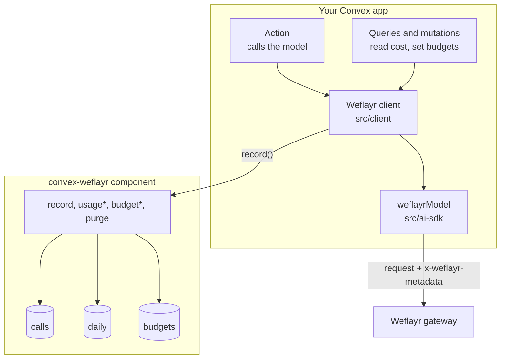

# Architecture

## Parts

- **Client** (`src/client`). A class your app creates once. It builds the
  metadata header, times and records calls, checks budgets and reads usage.
  It runs in your app's actions, queries and mutations.
- **AI SDK model** (`src/ai-sdk`). Returns an OpenAI compatible model pointed at
  the gateway, for use with `generateText` and `streamText`.
- **Component** (`src/component`). Three tables and the functions that write and
  read them. It is isolated from your own tables, so it cannot read your data
  and you cannot break its indexes.

## One call, step by step

1. The action calls `assertWithinBudget(customer)`. A customer over budget stops
   here, before any model cost.
2. `track()` starts a timer and runs your model call through the gateway with
   the metadata header: feature, call, customer, plan and run id.
3. When the call ends, `track()` works out the cost, in this order: a cost you
   pass, an estimate from `prices`, then zero.
4. `record()` writes one row to `calls` and adds the same numbers to the
   matching `daily` row, in one transaction.
5. If the call failed, the failure is recorded and the original error is thrown
   again.

## Tables

| Table     | Key                                   | Why                                                     |
| --------- | ------------------------------------- | ------------------------------------------------------- |
| `calls`   | by customer and time, by run, by time | The raw log. Can be purged by age.                      |
| `daily`   | customer, call, UTC day               | What every report reads, so reads stay cheap at scale. |
| `budgets` | customer                              | One monthly dollar limit per customer.                  |

Reports read `daily`, never `calls`. Purging old `calls` rows does not change
any report.

## Why a component

The tables live inside the component, so installing it adds no tables to your
schema and needs no migration in your app.

## Limits to know

- A budget is checked before a call starts. A call already running when the
  limit is reached can still finish.
- Cost is an estimate from your `prices` table unless you pass a real cost.
  Weflayr's dashboard is the source for what you were billed.
- Days and months are UTC.
